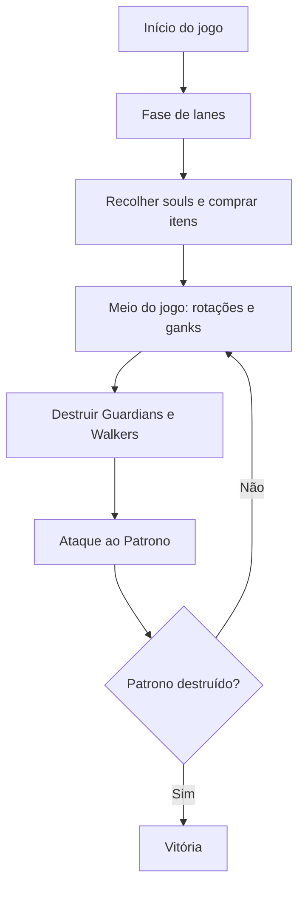
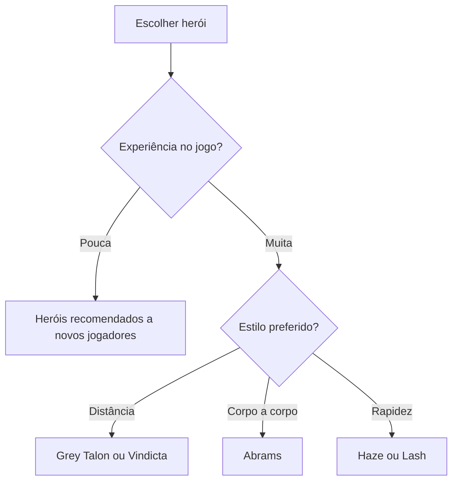
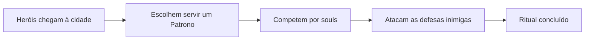
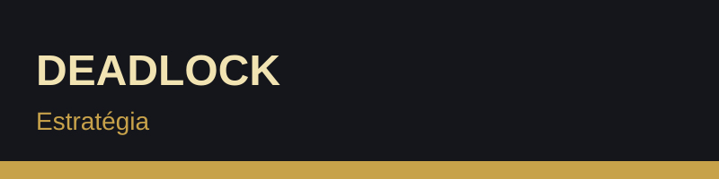
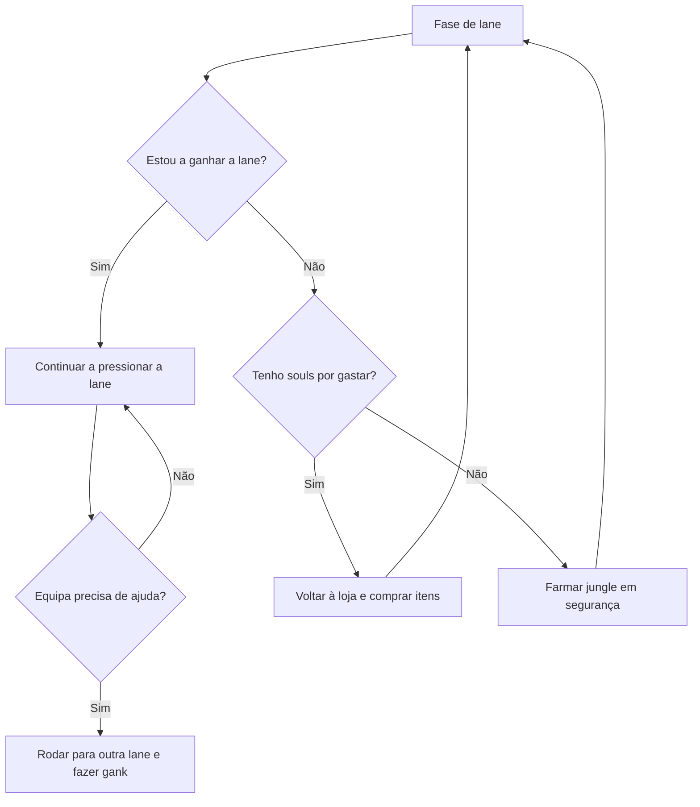
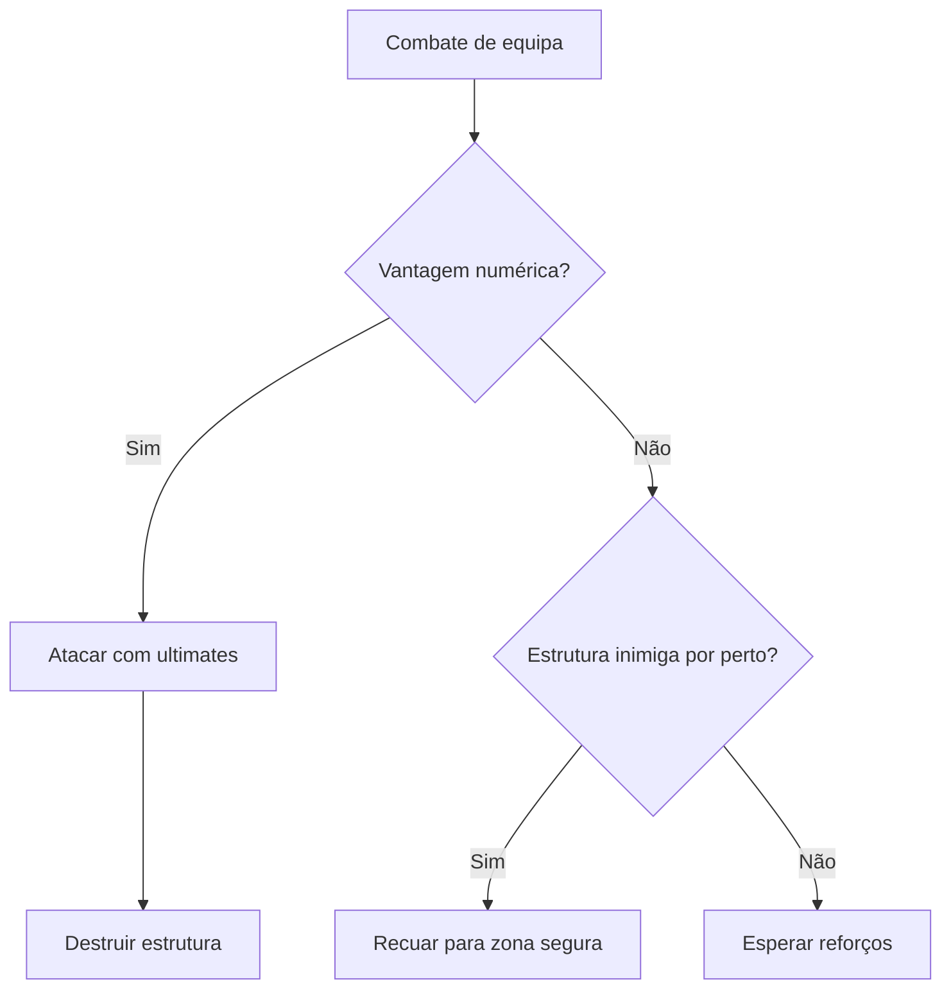

# Deadlock - Guia do Jogo

Documento colaborativo sobre o jogo **Deadlock**, criado no âmbito da disciplina de Introdução à Computação.

## Índice

1. [Introdução ao jogo](#1-introdução-ao-jogo)
2. [Personagens e itens](#2-personagens-e-itens)
3. [História e enredo](#3-história-e-enredo)
4. [Estratégia e walkthrough](#4-estratégia-e-walkthrough)
5. [Links úteis e fontes](#5-links-úteis-e-fontes)

## 1. Introdução ao jogo

**Deadlock** é um jogo multijogador desenvolvido e publicado pela **Valve**. Combina o tiroteio e o movimento de um *hero shooter* em terceira pessoa com as lanes, os objetivos e a progressão de um **MOBA**.

### Visão geral

- **Formato:** duas equipas de 6 jogadores
- **Perspetiva:** terceira pessoa
- **Recurso principal:** as *souls* (almas)
- **Mapa:** lanes ligadas por ruas e por *ziplines*
- **Estado:** em desenvolvimento, com alterações frequentes através de patches

### Jogabilidade

1. Cada jogador escolhe um herói único (não há heróis repetidos no mesmo jogo).
2. As equipas distribuem-se pelas lanes e eliminam tropas e heróis inimigos para ganhar souls.
3. As souls são gastas na loja em itens de **Arma**, **Vitalidade** e **Espírito**.
4. As equipas rodam entre lanes para fazer *ganks* e destruir estruturas.
5. A equipa que destruir o **Patrono** inimigo vence.

### Objetivos principais

- Controlar as lanes e recolher souls
- Destruir os *Guardians* e os *Walkers* inimigos
- Ganhar vantagem em equipa para atacar o Patrono

### Fluxo de um jogo

Mais informação: [Página oficial de Deadlock](https://www.playdeadlock.com/)

## 2. Personagens e itens

Os heróis de Deadlock não têm classes fixas. Qualquer herói pode ocupar qualquer lane, e cada um tem habilidades próprias que podem ser melhoradas com pontos de habilidade.

### Alguns heróis

| Herói | Estilo de jogo |
|-------|----------------|
| Abrams | Combate corpo a corpo, resistente |
| Haze | Furtiva, focada em eliminar alvos rapidamente |
| Grey Talon | Ataque à distância com arco |
| Vindicta | Atiradora de longo alcance com muita mobilidade |
| Wraith | Combate versátil com armas e habilidades |
| Lash | Mobilidade e controlo de combate |

### Características de um herói

- Armas e habilidades próprias
- Ataque corpo a corpo e parry
- Vida, stamina e velocidade de movimento
- Ultimate com grande impacto em combates de equipa

### Itens da loja

Os itens dividem-se em três categorias:

1. **Arma:** aumentam o dano e a eficiência das armas
2. **Vitalidade:** aumentam a vida e a resistência
3. **Espírito:** reforçam as habilidades

Cada categoria tem vários níveis, com custos crescentes de 800, 1600, 3200 e 6400 souls.

### Escolher um herói

Lista completa de heróis: [Guia de heróis e mecânicas (SteamDB)](https://steamdb.com/en/articles/deadlock-beginners-guide-heroes-and-mechanics)

## 3. História e enredo

Em Deadlock, heróis de todo o mundo reúnem-se numa cidade em conflito. Cada um serve um **Patrono** em troca da realização de um desejo pessoal.

### Enredo resumido

- Os Patronos precisam de completar rituais para concretizar os seus objetivos.
- Esses rituais exigem **souls**.
- Os heróis competem entre si para recolher souls e completar o ritual do seu Patrono.
- Quem destruir o Patrono rival garante o sucesso do seu.

### Elementos da história

- **Heróis:** personagens com motivações e origens diferentes
- **Patronos:** poderes que movem o conflito
- **Souls:** a moeda do jogo e o centro da narrativa
- **Cidade:** o cenário onde decorrem as batalhas

### Cronologia do conflito

Mais contexto: [Visão geral do jogo (Game8)](https://game8.co/articles/games/deadlock)

## 4. Estratégia e walkthrough

### Princípios básicos

1. **Souls primeiro:** as souls valem mais do que as kills isoladas.
2. **Farm limpo:** acertar o último golpe nas tropas dá mais souls.
3. **Gastar souls:** souls por gastar não tornam o herói mais forte.
4. **Jogar em equipa:** rotações coordenadas ganham mais jogos do que jogadas isoladas.

### Fases do jogo

| Fase | Duração aproximada | Objetivo |
|------|--------------------|----------|
| Início | 0 a 10 min | Ganhar a lane e recolher souls |
| Meio | 10 a 20 min | Rodar entre lanes e fazer ganks |
| Fim | 20+ min | Combates de equipa e ataque ao Patrono |

### Dicas úteis

- Escolher duplas de lane que se complementem
- Comprar itens baratos cedo para ganhar vantagem
- Não morrer com muitas souls por gastar
- Acompanhar os temporizadores de objetivos neutros

### Decisão durante a lane

### Decisão em combate

Guias: [Dicas para a fase de lane (Tacter)](https://www.tacter.com/deadlock/guides/5-tips-to-get-you-through-laning-phase-in-deadlock-and-into-high-mmr-97b6cda8) e [O que é Deadlock (Mobalytics)](https://mobalytics.gg/deadlock/guides/what-is-deadlock)

## 5. Links úteis e fontes

### Oficiais

- [Página oficial de Deadlock](https://www.playdeadlock.com/)
- [Página do jogo na Steam](https://store.steampowered.com/app/1422450/Deadlock/)

### Guias e comunidade

- [O que é Deadlock? (Mobalytics)](https://mobalytics.gg/deadlock/guides/what-is-deadlock)
- [Guia para iniciantes (SteamDB)](https://steamdb.com/en/articles/deadlock-beginners-guide-heroes-and-mechanics)
- [Dicas para a fase de lane (Tacter)](https://www.tacter.com/deadlock/guides/5-tips-to-get-you-through-laning-phase-in-deadlock-and-into-high-mmr-97b6cda8)
- [Visão geral do jogo (Game8)](https://game8.co/articles/games/deadlock)

### Inspiração

- MOBAs como Dota 2 e League of Legends
- Hero shooters como Overwatch e Team Fortress 2

