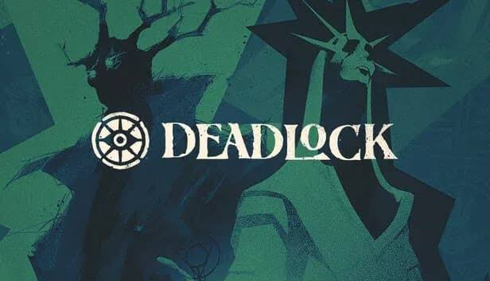

# ic-exercicio-aula8

## 4. Estratégia e walkthrough

**Princípios básicos**

1. Souls primeiro: as souls valem mais do que as kills isoladas.
2. Farm limpo: acertar o último golpe nas tropas dá mais souls.
3. Gastar souls: souls por gastar não tornam o herói mais forte.
4. Jogar em equipa: rotações coordenadas ganham mais jogos do que jogadas isoladas.

**Fases do jogo**

| Fase | Duração aproximada | Objetivo |
|---|---:|---|
| Início | 0 a 10 min| Ganhar a lane e recolher souls|
| Meio | 10 a 20 min| Rodar entre lanes e fazer ganks|
| Fim| 20+ min| Combates de equipa e ataque ao Patrono |

**Dicas úteis**

Escolher duplas de lane que se complementem
Comprar itens baratos cedo para ganhar vantagem
Não morrer com muitas souls por gastar
Acompanhar os temporizadores de objetivos neutros
Decisão durante a lane

flowchart TD
    A[Fase de lane] --> B{Estou a ganhar a lane?}
    B -- Sim --> C[Continuar a pressionar a lane]
    C --> D{Equipa precisa de ajuda?}
    D -- Sim --> E[Rodar para outra lane e fazer gank]
    D -- Não --> C
    B -- Não --> F{Tenho souls por gastar?}
    F -- Sim --> G[Voltar à loja e comprar itens]
    F -- Não --> H[Farmar jungle em segurança]
    G --> A
    H --> A

´´´
flowchart TD
    A[Combate de equipa] --> B{Vantagem numérica?}
    B -- Sim --> C[Atacar com ultimates]
    B -- Não --> D{Estrutura inimiga por perto?}
    D -- Sim --> E[Recuar para zona segura]
    D -- Não --> F[Esperar reforços]
    C --> G[Destruir estrutura]
Guias: Dicas para a fase de lane (Tacter) e O que é Deadlock (Mobalytics)

5. Links úteis e fontes

Oficiais
Página oficial de Deadlock
Página do jogo na Steam
Guias e comunidade
O que é Deadlock? (Mobalytics)
Guia para iniciantes (SteamDB)
Dicas para a fase de lane (Tacter)
Visão geral do jogo (Game8)
Inspiração
MOBAs como Dota 2 e League of Legends
Hero shooters como Overwatch e Team Fortress 2