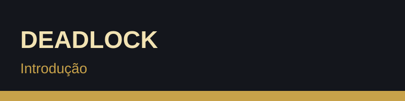
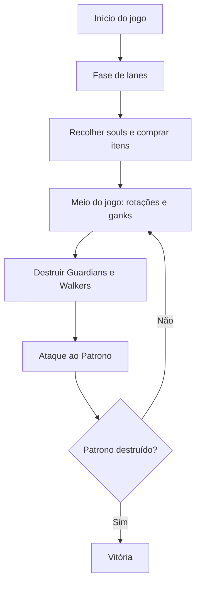

## 1. Introdução ao jogo

**Deadlock** é um jogo multijogador desenvolvido e publicado pela **Valve**. Combina o tiroteio e o movimento de um *hero shooter* em terceira pessoa com as lanes, os objetivos e a progressão de um **MOBA**.

### Visão geral

- **Formato:** duas equipas de 6 jogadores
- **Perspetiva:** terceira pessoa
- **Recurso principal:** as *souls* (almas)
- **Mapa:** lanes ligadas por ruas e por *ziplines*
- **Estado:** em desenvolvimento, com alterações frequentes através de patches

### Jogabilidade

1. Cada jogador escolhe um herói único (não há heróis repetidos no mesmo jogo).
2. As equipas distribuem-se pelas lanes e eliminam tropas e heróis inimigos para ganhar souls.
3. As souls são gastas na loja em itens de **Arma**, **Vitalidade** e **Espírito**.
4. As equipas rodam entre lanes para fazer *ganks* e destruir estruturas.
5. A equipa que destruir o **Patrono** inimigo vence.

### Objetivos principais

- Controlar as lanes e recolher souls
- Destruir os *Guardians* e os *Walkers* inimigos
- Ganhar vantagem em equipa para atacar o Patrono

### Fluxo de um jogo

Mais informação: [Página oficial de Deadlock](https://www.playdeadlock.com/)
