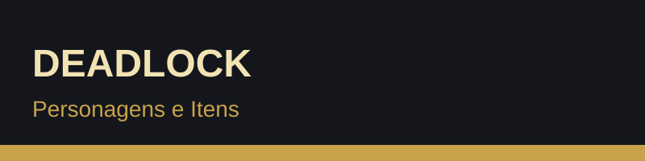
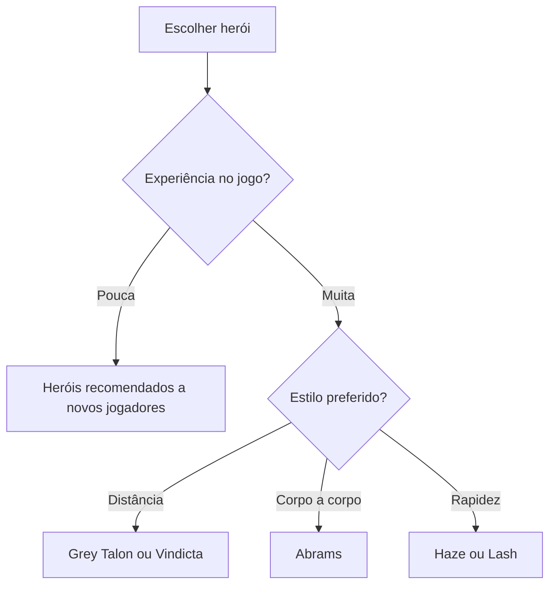

## 2. Personagens e itens

Os heróis de Deadlock não têm classes fixas. Qualquer herói pode ocupar qualquer lane, e cada um tem habilidades próprias que podem ser melhoradas com pontos de habilidade.

### Alguns heróis

| Herói | Estilo de jogo |
|-------|----------------|
| Abrams | Combate corpo a corpo, resistente |
| Haze | Furtiva, focada em eliminar alvos rapidamente |
| Grey Talon | Ataque à distância com arco |
| Vindicta | Atiradora de longo alcance com muita mobilidade |
| Wraith | Combate versátil com armas e habilidades |
| Lash | Mobilidade e controlo de combate |

### Características de um herói

- Armas e habilidades próprias
- Ataque corpo a corpo e parry
- Vida, stamina e velocidade de movimento
- Ultimate com grande impacto em combates de equipa

### Itens da loja

Os itens dividem-se em três categorias:

1. **Arma:** aumentam o dano e a eficiência das armas
2. **Vitalidade:** aumentam a vida e a resistência
3. **Espírito:** reforçam as habilidades

Cada categoria tem vários níveis, com custos crescentes de 800, 1600, 3200 e 6400 souls.

### Escolher um herói

Lista completa de heróis: [Guia de heróis e mecânicas (SteamDB)](https://steamdb.com/en/articles/deadlock-beginners-guide-heroes-and-mechanics)
