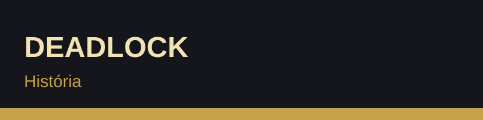
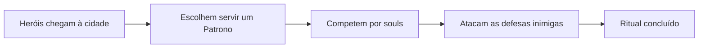

## 3. História e enredo

Em Deadlock, heróis de todo o mundo reúnem-se numa cidade em conflito. Cada um serve um **Patrono** em troca da realização de um desejo pessoal.

### Enredo resumido

- Os Patronos precisam de completar rituais para concretizar os seus objetivos.
- Esses rituais exigem **souls**.
- Os heróis competem entre si para recolher souls e completar o ritual do seu Patrono.
- Quem destruir o Patrono rival garante o sucesso do seu.

### Elementos da história

- **Heróis:** personagens com motivações e origens diferentes
- **Patronos:** poderes que movem o conflito
- **Souls:** a moeda do jogo e o centro da narrativa
- **Cidade:** o cenário onde decorrem as batalhas

### Cronologia do conflito

Mais contexto: [Visão geral do jogo (Game8)](https://game8.co/articles/games/deadlock)
