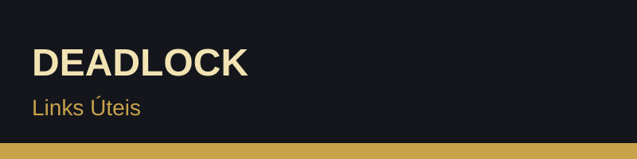

## 5. Links úteis e fontes

### Oficiais

- [Página oficial de Deadlock](https://www.playdeadlock.com/)
- [Página do jogo na Steam](https://store.steampowered.com/app/1422450/Deadlock/)

### Guias e comunidade

- [O que é Deadlock? (Mobalytics)](https://mobalytics.gg/deadlock/guides/what-is-deadlock)
- [Guia para iniciantes (SteamDB)](https://steamdb.com/en/articles/deadlock-beginners-guide-heroes-and-mechanics)
- [Dicas para a fase de lane (Tacter)](https://www.tacter.com/deadlock/guides/5-tips-to-get-you-through-laning-phase-in-deadlock-and-into-high-mmr-97b6cda8)
- [Visão geral do jogo (Game8)](https://game8.co/articles/games/deadlock)

### Inspiração

- MOBAs como Dota 2 e League of Legends
- Hero shooters como Overwatch e Team Fortress 2
